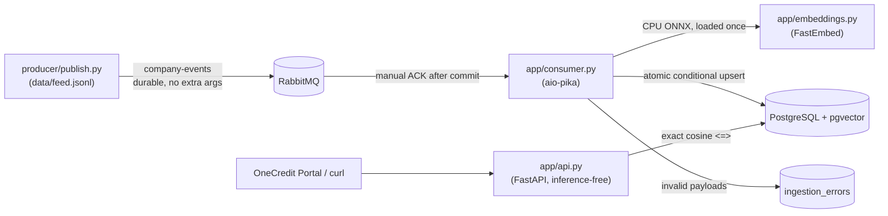

# DESIGN.md — OneCredit Company Recommendation Service

## 1. Product Goal & Scope

The goal is a reliable, fresh, low-latency **content-based company recommendation service** powering the **"Similar companies"** panel on the OneCredit portal. Given a company A, the service returns active peer companies with the most similar **nature of business**.

**Explicit scope boundary:**
- **Similarity ≠ lead suitability:** Vector similarity captures overlap in business activity descriptions. It does *not* encode creditworthiness, company size, financial health, or sales eligibility. Those signals belong in downstream business rules or a separate ranking stage.
- **Non-goals for v1:** LLMs, fine-tuning, collaborative filtering, external vector databases, paid APIs, or complex rerankers.

---

## 2. Architecture & Data Flow

- **Ingestion (`app/consumer.py`)** runs continuously, loads the CPU embedding model **once per worker**, runs CPU inference in a worker thread (`asyncio.to_thread`) so AMQP heartbeats are never blocked, and commits company fields + embedding atomically in PostgreSQL before ACKing RabbitMQ.
- **Retrieval (`app/api.py`)** is completely **online inference-free**: it looks up the target company's stored vector and runs parameterized pgvector cosine search (`<=>`) directly in PostgreSQL using a shared `psycopg_pool.ConnectionPool`.

---

## 3. Feed Profile, Assumptions & Messy-Feed Policies

Profiling all **2,518** lines of `data/feed.jsonl` before coding revealed a clean disjoint breakdown:

| Category | Count | Handling Policy |
|---|---:|---|
| Valid `company-upserted` (with `updatedAt`) | 2,473 | Normalize & conditionally upsert (`status = 'active'`) |
| `company-struck-off` (no `data` object) | 8 | Conditionally mark `status = 'struck_off'`, preserving stored metadata |
| Valid `company-upserted` (missing `updatedAt`) | 7 | Insert if new; never overwrite a timestamped row |
| Structurally invalid (malformed JSON: 5, JSON `null`: 6, missing `registrationNumber`: 7, integer `registrationNumber`: 3, missing `data`: 5, string `data`: 4) | 30 | Persist in `ingestion_errors` before ACK (deduplicates to 25 distinct `(message_id, error_type)` rows because the 6 `"null"` lines share one SHA-256 `message_id`) |
| **Total** | **2,518** | Resolves to **exactly 2,000** unique canonical companies (`1,992` active, `8` struck off; `1,961` with descriptions, `39` missing/blank descriptions) |

### Key Assumptions & Policies

1. **Canonical identity (`registrationNumber`):** Must be a non-empty string, normalized with `strip().upper()`. This collapses 49 whitespace/casing variants (e.g., `" syn-001988 "`, `"SYN-001988"`) into 2,000 canonical IDs without stripping internal characters. Non-string IDs (`119`, `1756`, `64` with dummy `"X"` payloads) and missing IDs are quarantined rather than allowed to pollute the registry.
2. **Timestamp parsing & timezone convention:**
   - Timezone-aware ISO-8601 strings (`+08:00`, `Z`) and Unix epoch milliseconds (`>= 1e12`, 30 events) are converted to UTC.
   - **Naive ISO-8601 timestamps (14 events)** are interpreted as **Asia/Kuala_Lumpur (`UTC+08:00`)** before converting to UTC. Inspection showed all 14 naive timestamps are exactly 1 minute after their `+08:00` sibling event; treating them as UTC would wrongly shift them +8 hours into the future and cause stale updates to overwrite newer records.
   - Raw `updatedAt` is preserved in `raw_updated_at` for auditability, and ingestion time (`ingested_at`) is never confused with source `updated_at`.
3. **Source-version precedence & deterministic ties:**
   - Any timestamped event beats an undated record; an undated event (e.g., the 7 `{"companyName": "Unknown"}` placeholders) may insert a brand-new company but never overwrites a timestamped row.
   - For timestamped rows, newer UTC `updated_at` wins.
   - For exact timestamp ties (or two undated events), a deterministic SHA-256 `event_version_key` computed from canonical normalized fields breaks ties via strict `>` — making final state arrival-order independent and turning exact replays into clean no-ops.
4. **Full snapshots & `company-struck-off`:** Inspection confirmed zero cases of a newer dated `company-upserted` event omitting or nullifying previously populated fields, so dated upserts are treated as full snapshots. For the 8 `company-struck-off` events, rows are retained with `status = 'struck_off'` (satisfying *no lost companies*) while being excluded from recommended peer lists (`WHERE status = 'active'`). If a newer `company-struck-off` arrives out of order *before* an older `company-upserted`, the conditional upsert backfills `NULL` metadata/embedding fields via `COALESCE` while keeping `status = 'struck_off'` and the newer `updated_at` locked — so both arrival orders converge to the same complete record.
5. **No-lost-company policy, field normalization & repeated-text deduplication:**
   - Companies with `null` or blank `natureOfBusiness` (39 companies) are stored with `embedding = NULL` — never dropped and never given fabricated descriptions or scores.
   - `state` has 46 raw casing variants that collapse cleanly via Title Case into the 16 Malaysian states/territories.
   - `natureOfBusiness` preserves raw trimmed text in PostgreSQL, while `prepare_embedding_text()` deterministically collapses corrupted consecutive phrase repetitions (`>= 3` exact consecutive repeats covering the string). Profiling found 7 companies (`SYN-000185`, `SYN-000229`, `SYN-000300`, `SYN-000374`, `SYN-000407`, `SYN-001016`, `SYN-001316`) whose descriptions were repeated 50–60 times (1,439–3,359 chars), causing 128-token truncation to depress cosine similarity from `1.00` down to `0.6666–0.7867`; deduplicating the embedding input restored all 7 to **`1.0000`** with their exact peers. Extra top-level keys (`source`, `ingestedBy`) are safely ignored.

---

## 4. Technical Decisions & Trade-Offs

### 4.1 Embedding Model: `sentence-transformers/paraphrase-multilingual-MiniLM-L12-v2` via `fastembed`
- **Why multilingual instead of `BAAI/bge-small-en-v1.5`:** Active descriptions in `data/feed.jsonl` are **~69% English (1,341)** and **~31% Bahasa Melayu (612)**, with direct EN/MS activity equivalents (e.g., *"Boutique hotel in Penang"* ↔ *"Hotel butik di Seremban"*). As measured in Section 5, `bge-small-en-v1.5` collapses on cross-lingual retrieval (`0.245` vs `0.855` P@5).
- **Why not translate to English:** Paid APIs/LLMs are prohibited; adding a local CPU neural machine translation model doubles ML footprint, slows ingestion, and risks mangling local Malaysian business terms (*PKS*, *taska*, *runcit*).
- **Why `paraphrase-multilingual-MiniLM-L12-v2` + `fastembed`:**
  - Trained specifically for **symmetric sentence-to-sentence similarity** (no asymmetric `query:`/`passage:` prefixes required, matching our online inference-free `embedding <=> embedding` design).
  - Supports 50+ languages explicitly including Malay (`ms`), Indonesian (`id`), and English (`en`).
  - Runs via quantized ONNX Runtime on CPU (~220 MB download, 384 dimensions) with clean Python 3.14 wheel support — avoiding ~3+ GB of `torch`/CUDA wheels (`sentence-transformers`) or 2.2 GB downloads (`multilingual-e5-large`, `bge-m3`).
- **Trade-off:** Truncates inputs at 128 tokens (sufficient for all normal business descriptions once consecutive phrase repetitions are collapsed in `prepare_embedding_text()`).

### 4.2 Why Not Hybrid Search (BM25 / SPLADE) in v1?
- **BM25 (`tsvector` / lexical search):** Scores `0.0` across English ↔ Bahasa Melayu pairs (*"Boutique hotel"* vs. *"Hotel butik"*), amplifies city-name lexical false positives (*"Penang"*, *"Klang Valley"*) across unrelated industries, and PostgreSQL lacks a native Malay stemmer.
- **SPLADE (`fastembed`'s `Splade_PP_en_v1`):** Uses an English-only BERT WordPiece vocabulary (unsuitable for the ~31% Malay catalog) and doubles ingestion CPU inference, vector storage (`sparsevec`), and query fusion complexity.
- **Measured reality:** Across all 1,855 active companies with known industry (9,275 Top-5 slots), pure multilingual dense retrieval already achieved **0 / 9,275 (`0.000%`) cross-industry Top-5 leaks**. Hybrid search (dense + multilingual sparse/BM25 via RRF) becomes worthwhile later on real SSM filings containing rare MSIC codes, acronyms, or certifications (*"CIDB G7"*, *"CNC turning"*) — or for the portal's free-text `"Search companies..."` bar — once offline human-labeled evals demonstrate a real gain.

### 4.3 PostgreSQL Schema & Atomic Concurrency Control
- Compact two-table schema ([`migrations/001_initial.sql`](migrations/001_initial.sql)): `companies` (`registration_number PRIMARY KEY`, portal fields, `status`, `updated_at`, `raw_updated_at`, `event_version_key`, `embedding vector(384)`, `embedding_model`, `embedding_text_hash`) and `ingestion_errors` (`UNIQUE (message_id, error_type)`).
- **Database-side conditional upsert** (`INSERT ... ON CONFLICT (registration_number) DO UPDATE ... WHERE <version_guard>`) commits metadata and embedding atomically in one transaction. Even if two workers process competing versions concurrently, PostgreSQL's row lock enforces the final freshness decision.
- **Pool resilience:** `create_pool()` enables `check=ConnectionPool.check_connection` so broken/restarted PostgreSQL connections are recycled transparently, and `_configure_connection()` handles a pre-migration database without crashing API startup (`min_size=0` on the API pool).
- A preliminary version/hash read is used strictly as an optimization: stale/duplicate deliveries skip ONNX inference completely, and metadata-only updates (e.g., company renames with unchanged `natureOfBusiness`) reuse the existing vector while still committing atomically.

### 4.4 Exact `pgvector` Cosine Search & Locality-Aware Tie-Breaking
- With 1,953 active vectorized companies, exact cosine search (`c.embedding <=> src.embedding`) executes in **1.474 ms** (`EXPLAIN ANALYZE`, `top-N heapsort`, 25 kB memory), and end-to-end HTTP `curl` latency is **2–7 ms**.
- **Locality-aware tie-breaking:** Full-catalog inspection showed **83.5% (`1,549 / 1,855`)** of active companies have >5 exact `1.0` cosine ties. Ordering by `ROUND((c.embedding <=> src.embedding)::numeric, 5) ASC`, then `CASE WHEN src.state IS NOT NULL AND c.state = src.state THEN 1 ELSE 0 END DESC`, then same `industry`, then `registration_number ASC` keeps pure vector similarity strictly primary while surfacing same-state Malaysian peers first on ties (using explicit `CASE` to avoid PostgreSQL's `DESC NULLS FIRST` pitfall).

### 4.5 RabbitMQ Semantics & Failure Handling
- Consumes `company-events` with `durable=True` and **no extra queue arguments**, preserving the registry team's queue declaration.
- **Commit-before-ACK:** `message.ack()` runs only *after* PostgreSQL commits the upsert, struck-off update, or quarantine insert (or confirms the event is stale/duplicate).
- **Transient vs. deterministic failures:**
  - Transient DB/network errors (`psycopg.Error`, `PoolTimeout`, `OSError`, `TimeoutError`) retry up to `MAX_TRANSIENT_RETRIES=3` with exponential backoff (`1s`, `2s`, `4s`) before `nack(requeue=True)` + backoff sleep (no high-CPU requeue spin loop).
  - Unexpected deterministic non-DB processing errors (e.g., a model `ValueError` on a poison message) are durably quarantined into `ingestion_errors` (`error_type = 'processing_error'`) before ACKing so a single poison pill cannot stall the consumer infinitely.
  - **Quarantine caveat:** If PostgreSQL itself is unreachable while quarantining a bad message, the quarantine write fails as a transient DB error, so the message is *not* ACKed (`nack(requeue=True)` with backoff) and is quarantined once PostgreSQL recovers.

### 4.6 API Response & Error Contract
- `GET /companies/{registration_number}/similar?limit=5`:
  - `200 OK` (`matchType: "semantic"`): returns company metadata, `status`, and ranked `recommendations` (`similarity = 1 - cosine_distance`, rounded to 4 decimals). Unknown optional fields (`industry`, `state`) serialize as `null`.
  - `200 OK` (`matchType: "industry_fallback"`, `similarity: null`): when a known company has `embedding IS NULL` but has real `industry` metadata (35 of the 39 companies missing descriptions), returns same-industry active peers preferring the same `state` with an explicit fallback `message` — never fabricating cosine scores.
  - `200 OK` (`recommendations: []` + explicit `message`): when a company lacks *both* description and industry (4 companies, e.g. `SYN-000048`) or no active candidates exist.
  - Querying a `struck_off` company directly returns `200 OK` with `"status": "struck_off"` and active similar peers, while struck-off companies are never recommended on other companies' pages.
  - `404 Not Found`: unknown registration number.
  - `422 Unprocessable Entity`: blank ID or `limit` outside `1..20`.
  - `503 Service Unavailable`: PostgreSQL connection/pool failure (also surfaced on `GET /health`).

---

## 5. Deep Dive (P2): Measured Multilingual vs. English-Only Evaluation

Reproducible command: `uv run python -m scripts.eval_models` ([`scripts/eval_models.py`](scripts/eval_models.py)).

**Setup:** Evaluated across all **1,953 active companies** with non-empty descriptions (`1,341` English, `612` Bahasa Melayu) using a deterministic **22-query panel** (1 English + 1 Malay query from every one of the 11 industries, including `SYN-001550`). To isolate cross-lingual alignment beyond same-language template duplicates, we measure both **Full-Catalog Same-Industry P@5** and **Cross-Lingual Same-Industry P@5** (English queries scored strictly against the 612 Malay candidates; Malay queries scored strictly against the 1,341 English candidates).

| Metric (observed on local CPU, Intel Core i9-14900HX) | `paraphrase-multilingual-MiniLM-L12-v2` (Chosen) | `BAAI/bge-small-en-v1.5` (Starter) |
|---|---:|---:|
| Model download size (ONNX quantized) | `~220 MB` | `~67 MB` |
| CPU embed time (1,953 descriptions) | **14.28 s** (`136.7 docs/s`) | `53.56 s` (`36.5 docs/s`) |
| Full-catalog Same-Industry P@5 (22 queries) | `0.891` (EN `0.909`, MS `0.873`) | `0.927` (EN `0.891`, MS `0.964`) |
| **Cross-Lingual Same-Industry P@5 (Overall)** | **`0.855`** | `0.245` |
| Cross-Lingual `EN -> MS` P@5 (11 queries) | **`0.709`** | `0.345` |
| Cross-Lingual `MS -> EN` P@5 (11 queries) | **`1.000`** | `0.145` |
| Cross-lingual queries with `P@5 < 0.80` | **3 / 22** | `17 / 22` |

### Key Findings & Failure Analysis
1. **Cross-lingual collapse in `bge-small-en-v1.5`:** On `SYN-001550` (*"Operating cafes and coffee shops in the Klang Valley"*), `bge-small-en-v1.5` ranked a Malay Logistics company (*"Penghantaran bungkusan ke seluruh the Klang Valley"*, `sim=0.8301`) in its top-3 cross-lingual matches by latching onto the English location words `"the Klang Valley"` — the exact off-industry failure pattern visible in the upstream README mock. On Malay Agriculture (`SYN-000019`, *"Ladang kelapa sawit dan pembekalan buah tandan segar"*), `bge-small-en-v1.5` returned English kindergartens (`sim=0.7060`), whereas `paraphrase-multilingual-MiniLM-L12-v2` returned exact English oil palm plantations (`sim=0.7988`).
2. **Why `bge-small-en-v1.5` had slightly higher full-catalog MS P@5 (`0.964` vs `0.873`):** Because `bge-small-en-v1.5` isolates Malay descriptions into a separate subspace, Malay queries only matched exact Malay template duplicates. Meanwhile, `paraphrase-multilingual-MiniLM-L12-v2` mixes English and Malay peers freely, and ~5.1% of catalog rows have `industry = NULL`, which strictly counts as a miss under `cand.industry == query.industry` even when the description is identical.
3. **Observed failure modes of `paraphrase-multilingual-MiniLM-L12-v2` (3 / 22 cross-lingual queries):**
   - `SYN-000004` (`Logistics`: *"Trucking services for construction materials"*) matched Malay `Construction` (*"Kerja-kerja kejuruteraan awam jalan dan saliran"*, `sim=0.485`) via construction domain overlap.
   - `SYN-000006` (`Professional Services`: *"Architectural design and planning services"*) matched Malay civil engineering (`Construction`, `sim=0.508`) — semantically adjacent across industry labels.
   - `SYN-000061` (`Technology`: *"IT support and network installation for offices in Johor Bahru"*) matched Malay `Retail` (*"Penjualan telefon bimbit dan aksesori di Johor Bahru"*, `sim=0.612`) due to city + device overlap.
4. **Caveats:** This dataset is synthetic (174 unique active descriptions repeated across 1,953 rows) and industry-label match is an imperfect proxy for business similarity (some cross-industry matches like architecture ↔ civil engineering are arguably useful, while NULL-industry true matches are penalized). Real production evaluation requires human relevance judgments on real SSM descriptions.

---

## 6. Testing Methodology & Observed Results

| Check | Command | Observed Result |
|---|---|---|
| Static lint & formatting | `uv run ruff check . && uv run ruff format --check .` | Passed (0 issues, 21 files formatted) |
| Fast offline unit tests | `uv run pytest -m "not integration" -q` | **16 passed** (`0.41 s`) — ID/state normalization, repeated-text deduplication, timestamps (UTC/MYT/epoch-ms/missing/invalid), version ties, quarantine parsing |
| Full automated suite | `uv run pytest -v` | **41 passed** (`2.00 s`) — adds isolated `companies_test` Postgres/pgvector versioning, out-of-order struck-off backfill & rollback tests, FastAPI locality tie-breaking, `industry_fallback`, `NULLS`-safe ordering & `503` outage tests, commit-before-ACK / poison-pill quarantine / pool connection recovery / live RabbitMQ redelivery tests, and real ONNX multilingual smoke test |
| Full-feed ingestion & independent ground-truth audit | `uv run python -m app.database` + `uv run python -m app.consumer` + ground-truth comparison | Drained 2,518 events in `23.04 s` (`applied=2355`, `stale_or_duplicate=133`, `quarantined=30`, `exit=0`); **2,000 / 2,000** companies match ground truth (`1,961` valid 384-dim vectors, `39` `NULL` embeddings, `1,992` active, `8` struck off, `25` distinct `ingestion_errors`, all 7 repeated-text companies restored to `1.0000` similarity) |
| Full second-replay snapshot stability | `uv run python -m producer.publish` + `app.consumer` + full before/after SHA-256 table snapshot | Drained 2,518 messages in `6.19 s` (`applied=0`, `stale_or_duplicate=2488`, `quarantined=30`, `transient_nacks=0`, clean `SIGTERM` exit `0`); **0 diffs** across all 2,000 company rows and 25 error rows |
| Live API latency (`EXPLAIN ANALYZE` + `curl`) | `uvicorn app.api:app` + `curl` + `psql EXPLAIN ANALYZE` | `1.474 ms` Postgres execution time; `1.1–6.5 ms` end-to-end HTTP responses across `/health`, EN/MS semantic queries, `industry_fallback`, empty fallback, `404`, and `422` |

---

## 7. What Changes at 10x Volume (With Measured Benchmarks)

Reproducible command: `uv run python -m scripts.benchmark_scale` ([`scripts/benchmark_scale.py`](scripts/benchmark_scale.py), runs on isolated `companies_test` using realistic clustered 384-dim unit vectors around 50 topic centroids, 50 queries per scale):

### 7.1 Measured PostgreSQL `pgvector` Latency & Recall (`m=16, ef_construction=64`, default `ef_search=40`)

| Catalog Size | Exact Scan p50 / p95 | HNSW Build Time | HNSW p50 / p95 | HNSW Recall@5 vs. Exact |
|---:|---:|---:|---:|---:|
| **2,000 (1x)** | `0.46 ms` / `0.56 ms` | `0.31 s` | `0.31 ms` / `0.51 ms` | `0.9960` |
| **20,000 (10x)** | **`4.41 ms` / `4.90 ms`** | `2.20 s` | `0.60 ms` / `0.76 ms` | `0.9080` |
| **50,000 (25x)** | `13.76 ms` / `16.42 ms` | `14.56 s` | `0.71 ms` / `0.88 ms` | `0.8400` |

**Takeaway:** Even at **10x scale (20,000 companies)**, exact cosine scan stays under **5 ms p95** with **100% recall** — confirming we do not need HNSW prematurely. Beyond **50,000+ companies**, a partial HNSW index (`WHERE status = 'active' AND embedding IS NOT NULL`) cuts p95 from `16.4 ms` to `< 1 ms`, **provided** `hnsw.ef_search` is tuned upward from the default `40` to maintain Recall@5 > 0.95 (note that default `ef_search=40` dropped Recall@5 to `0.84` at 50k!).

### 7.2 Measured ONNX CPU Micro-Batch Throughput (256 real descriptions)

| Batch Size | Total Time (256 docs) | Throughput | Notes |
|---:|---:|---:|---|
| `1` | `0.868 s` | `294.8 docs/s` | Current sequential consumer baseline |
| **`16`** | **`0.703 s`** | **`364.1 docs/s`** | **+23% throughput** — best micro-batch sweet spot |
| `64` | `1.799 s` | `142.3 docs/s` | Slower without length bucketing due to padding to max sequence length in the batch |

### 7.3 Operational Scaling Steps at 10x+
1. **Consumer concurrency & small micro-batches:** Run 2–4 horizontal consumer replicas (safe because DB-side conditional upserts enforce final freshness) and optionally micro-batch 8–16 messages with length bucketing rather than large unbucketed batches.
2. **Database connection pooling:** Place PgBouncer (transaction pooling) in front of PostgreSQL as API and consumer replicas scale.
3. **Re-embedding / model upgrades:** Persisted `embedding_model` and `embedding_text_hash` already support safe offline backfill jobs when migrating models (shadow column swap if dimensions change).
4. **Observability & alerting:** Export metrics for RabbitMQ queue depth and consumer lag, quarantine error rate (`ingestion_errors` spikes), transient DB retry/nack counts, API p50/p95/p99 latency and `503` rate, and embedding coverage ratio (`COUNT(embedding) / COUNT(*)`).

---

## 8. Limitations, Deferred Work & Honest Next Steps

- **Location token bias:** As seen in `SYN-000061` (*Johor Bahru*), city names inside `natureOfBusiness` can pull geographically co-located companies from unrelated industries in cross-lingual retrieval. Stripping location suffixes or adding an offline-validated metadata reranker is a natural next iteration on real SSM data.
- **No authentication, rate limiting, or pagination:** Assumed internal portal-to-service traffic behind an API gateway.
- **Minor test dependency warning:** Starlette 1.10 logs a deprecation warning about `httpx` vs. `httpx2` in `TestClient` during `pytest`; non-blocking.
- **Real-world SSM evaluation:** Synthetic data repeats 174 descriptions across 1,953 active companies; production deployment requires human relevance judgments on real SSM descriptions before tuning rerankers or HNSW `ef_search`.

---

## 9. AI Usage Disclosure

- **Tools used:** Antigravity (Google DeepMind coding assistant) in the local IDE workspace.
- **What it was used for:**
  - Inspecting and profiling `data/feed.jsonl` anomalies and verifying Python 3.14 wheel compatibility (`fastembed`, `psycopg`, `pgvector`, `fastapi`).
  - Researching CPU multilingual embedding models and comparing tradeoffs (`paraphrase-multilingual-MiniLM-L12-v2` vs. `BAAI/bge-small-en-v1.5`, and evaluating whether hybrid search such as BM25/SPLADE was justified).
  - Implementing the SQL migration (`migrations/001_initial.sql`), application modules (`app/*`), automated test suite (`tests/*`), evaluation/benchmark scripts (`scripts/eval_models.py`, `scripts/benchmark_scale.py`), `README.md`, and `DESIGN.md`.
  - Running root-cause audits and implementing reliability/UX hardening (pool connection health checks, poison-pill quarantine, out-of-order `company-struck-off` backfill, repeated-text deduplication, NULL-safe locality tie-breaking, and `industry_fallback`).
- **Human direction & verification:** Architectural decisions (such as choosing a multilingual ONNX model over English-only or translation, skipping BM25/SPLADE, and prioritizing reliability/UX fixes) were directed and reviewed by me. Every command, migration, live RabbitMQ/Postgres full-feed ingest, ground-truth row comparison, replay snapshot check, `curl` call, `EXPLAIN ANALYZE`, evaluation/benchmark script, `pytest` run (`41 passed`), and `ruff` check was executed locally, and all reported metrics reflect observed outputs.
